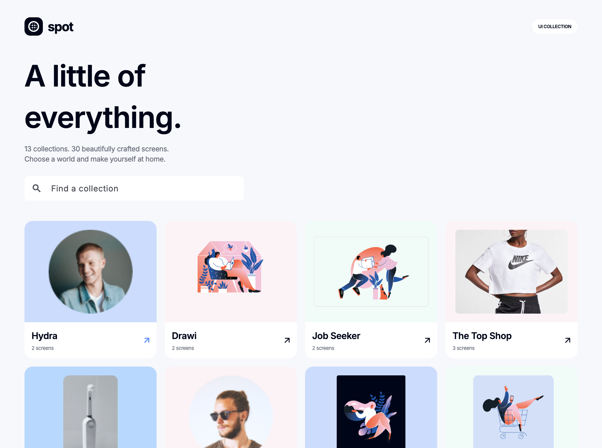
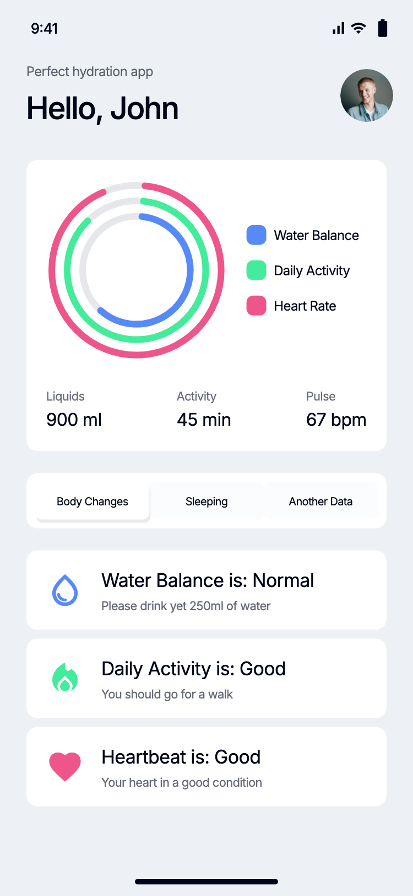
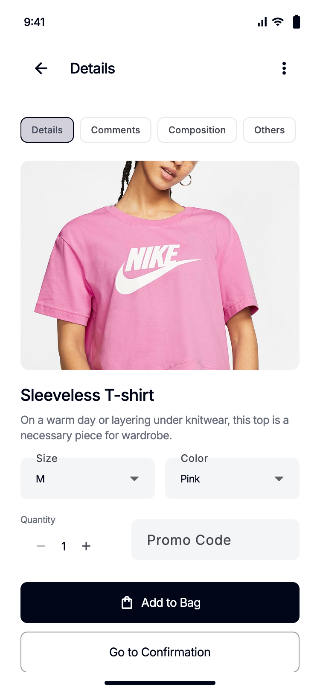
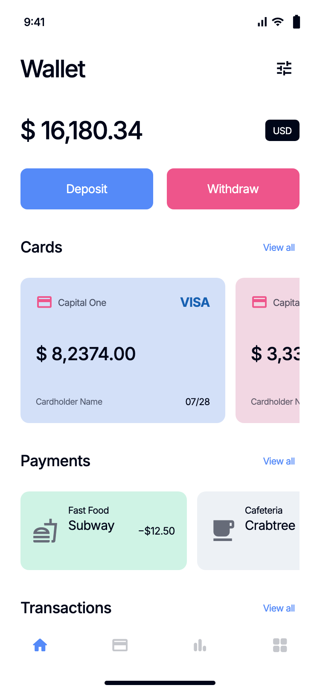
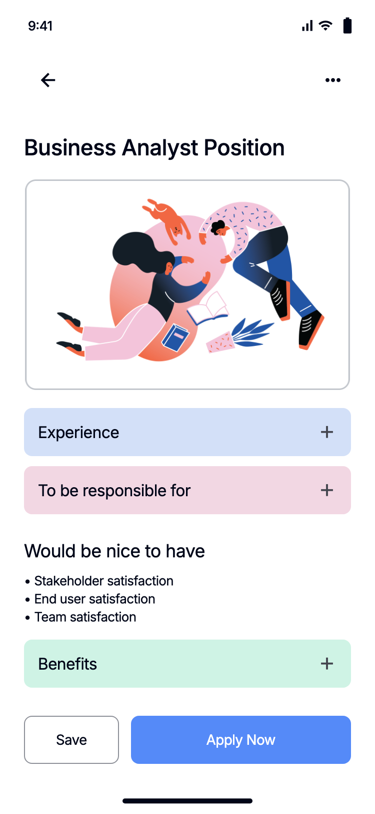
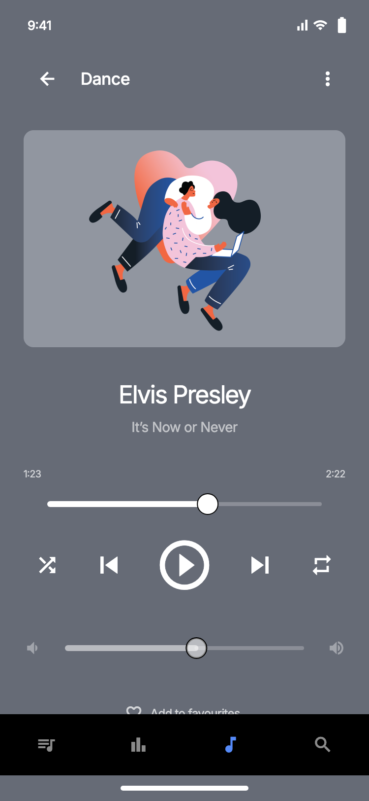
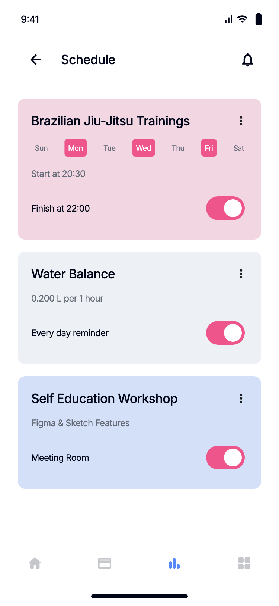

# Spot · Flutter UI Collection

基于 Pixso **Spot UI Kit** 实现的 Flutter 应用，包含 **13 个产品分类、30 个业务界面**，以及一个统一的分类入口。保留参考稿的英文文案、Inter 字体、蓝色主色和粉彩卡片，并为主要按钮补上本地交互。



## 设计文件覆盖范围

已读取参考文件的全部 3 个页面分类，而非只读取当前画布：

| Pixso 分类 | 内容 | 在项目中的对应实现 |
| --- | --- | --- |
| UI Kit | 13 类产品，30 个手机界面 | `lib/features/` 下的业务界面 |
| Styles | Color Style、Text Style 两个基础规范板，24 个本地样式 | `SpotColors`、Inter 字体和共享文本样式 |
| Symbols | 104 个图标、按钮、输入框、导航栏等组件 | 共享页头、按钮、卡片、筛选、导航和图表组件 |

参考文件：[Spot UI Kit](https://pixso.cn/app/design/UZg8yNfqqZTxWDWkgDnSNQ?page-id=0%3A1)。原始节点编号、原稿截图和实现截图的对应关系保存在 [source-map.json](docs/design/source-map.json)。Styles、Symbols 是设计基础规范；应用的业务页面来自 UI Kit。

## 主要界面

以下为真实 Flutter 组件渲染截图，业务界面采用原生控件实现。图片、头像和插画使用从 Pixso 导出的本地素材。

| 饮水与健康 | 商品详情 | 钱包 |
| --- | --- | --- |
|  |  |  |

| 职位详情 | 音乐播放 | 健身日程 |
| --- | --- | --- |
|  |  |  |

完整的 30 页截图、原稿对照和页面编号见 [界面清单](docs/SCREENS.md)。全部实现截图总览见 [screens-overview.jpg](docs/screens-overview.jpg)。

## 已实现的页面与交互

| 分类 | 页数 | 可操作内容 |
| --- | ---: | --- |
| Hydra | 2 | 健康标签切换、周期切换、增加 150 / 250 / 500 ml 饮水记录 |
| Drawi | 2 | 发现页、绘画教程、完成课程标记 |
| Job Seeker | 2 | 岗位搜索、分类选择、职责展开、收藏、保存求职意向 |
| The Top Shop | 3 | 商品搜索、详情标签、尺码 / 颜色 / 数量选择、购物袋、表单校验、演示下单 |
| T-Brush | 3 | 商品发现、列表与详情、颜色 / 数量选择、加入购物袋 |
| Everyday Bank | 3 | 银行概览、订阅历史、联系人选择、拖动余额卡片触发转账、金额校验 |
| Illustration Shop | 3 | 菜单、插画推荐、插画详情、加入购物袋、演示结算 |
| Daily Journal | 2 | 营养统计、早餐详情、添加早餐后更新卡路里 |
| Wallet | 2 | 钱包、卡片滑动、交易历史、存入 / 提取金额与余额校验 |
| Spot Music | 2 | 媒体库、播放 / 暂停、上一首 / 下一首、进度 / 音量滑杆、收藏 |
| ShoeShop | 2 | 商品集合、品牌选择、商品详情、尺码选择、收藏、购物袋 |
| Fitness Smart | 2 | 健康分类、日程、提醒开关 |
| Your Purchases | 2 | 购买记录、新增本地购买项、支付卡片选择 |

饮水总量、营养统计、收藏、课程完成标记、求职意向、购物袋数量、演示订单、余额、日程开关和支付卡片选择通过 `shared_preferences` 保存在本机。筛选、滚动位置和播放进度属于当前界面状态。

当前交付是**可运行的 UI 应用与本地业务演示**。登录、真实职位投递、线上商品数据、真实支付 / 银行转账和音频播放服务尚未接入；音乐页会推进播放进度，但不会播放音频。卡片为演示数据，未接入银行卡收集服务。

## 项目结构

```text
Spot/
├── lib/
│   ├── main.dart                     # 初始化本地存储，启动应用
│   ├── app/
│   │   ├── spot_app.dart              # 应用外壳、分类切换、手机 / 桌面布局
│   │   └── screen_registry.dart       # 13 类产品与 30 个页面标识
│   ├── core/
│   │   ├── app_state.dart             # 共享业务状态与本地持久化
│   │   ├── spot_theme.dart            # 配色、字体和输入框主题
│   │   └── widgets.dart               # 页头、卡片、按钮、导航、环形图、柱形图
│   └── features/
│       ├── catalog/                  # 产品分类入口与搜索
│       ├── wellness/                 # 饮水、营养和健身
│       ├── creative/                 # 绘画、插画、招聘和音乐
│       ├── commerce/                 # 服饰、鞋店和牙刷商城
│       └── finance/                  # 银行、钱包和订阅购买
├── assets/
│   ├── fonts/                        # Inter 字体及 OFL 许可证
│   └── images/                       # Pixso 导出的本地图片素材
├── test/                             # 全页面渲染、布局与关键流程检查
├── docs/
│   ├── SCREENS.md                    # 30 页原稿与实现截图对照
│   ├── VALIDATION.md                 # 验证结果与运行限制
│   ├── screenshots/                  # 30 张 Flutter 运行渲染截图
│   └── design/                       # 原稿截图、图层信息和节点映射
├── android/                          # Android 宿主
├── ios/                              # iOS 宿主
└── macos/                            # macOS 宿主
```

## 架构说明

界面层按产品领域组织，通用视觉元素集中在 `core/widgets.dart`；分类及页面编号由 `screen_registry.dart` 统一声明。界面通过回调切换页面，通过 `AppState` 更新共享数据；`ListenableBuilder` 只在状态改变时触发界面更新，`shared_preferences` 负责落盘。

```text
界面操作 → AppState → 通知界面刷新
                └──→ shared_preferences → 本机存储
```

没有额外引入路由框架、依赖注入容器或大型状态库。项目仅使用 Flutter 与 `shared_preferences`，便于阅读和继续开发。列表可以滚动，横向卡片和筛选独立滚动；桌面提供分类侧栏和手机等比预览，小窗口也会保持手机内容的布局比例。

增加新页面时，在对应 `features` 文件中加入页面实现，然后更新 `screen_registry.dart` 的页面名称与截图标识即可。后续连接真实服务时，可把持久化和业务请求从 `AppState` 拆入 repository，不需要重写界面。

## 运行

开发环境：Flutter **3.41.6**、Dart **3.11.4**。

```bash
flutter pub get
flutter run -d macos
```

运行到 Android / iOS 设备：

```bash
flutter devices
flutter run -d <设备编号>
```

直接打开某个页面：

```bash
flutter run -d macos --dart-define=SCREEN=shop-detail
```

可用页面标识见 [界面清单](docs/SCREENS.md)。清除应用本机数据后，演示数据会恢复默认值。

## 验证与截图再生成

```bash
flutter analyze
flutter test --concurrency=1
flutter build macos --debug
flutter build apk --debug
```

`test/widget_test.dart` 检查 30 个页面并生成 `docs/screenshots/*.png`；每张图为 **750 × 1624 px**，对应 **375 × 812** 逻辑像素的手机视口。图片中的状态栏及底部指示条仅用于截图和桌面预览，移动设备使用系统自身的安全区域。

`test/layout_test.dart` 补充检查小屏手机和较小桌面窗口；`test/catalog_capture_test.dart` 生成分类入口与桌面预览截图。具体执行结果见 [验证记录](docs/VALIDATION.md)。

## 素材与代码整理

图像和插画来自用户提供的 Pixso 文件，Inter 字体采用随附的 [SIL Open Font License](assets/fonts/OFL.txt)。图标使用 Flutter 自带的 Material Icons；少量图标形状、交互控件与静态稿存在差异。

已把重复视觉结构收敛为共享组件，移除 Flutter 默认计数器示例、未引用素材和未使用的 Pixso 生成代码。原稿截图仅用于文档对照，未作为业务页面整体背景使用。

如需重新生成截图总览与 Markdown 索引，安装 Pillow 后执行：

```bash
python tool/build_gallery.py
```

## 本机交付文件

- [macOS 应用](build/macos/Build/Products/Debug/Spot.app)
- [Android Debug 安装包](build/app/outputs/flutter-apk/app-debug.apk)
- [Flutter 源码压缩包](deliverables/Spot-source.zip)

源码包包含代码、资源、说明文档和截图，不包含可重新生成的构建目录；以上应用和安装包是当前工作目录中的构建产物。
